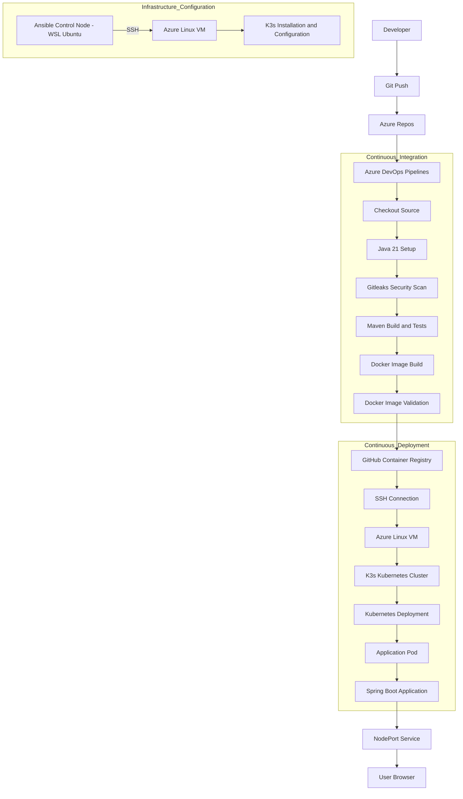

# ☁️ CloudForge – Design and Implementation of an End-to-End Cloud-Based CI/CD Pipeline


**CloudForge** is an end-to-end cloud-based Continuous Integration and Continuous Deployment (CI/CD) project that automates the process of building, testing, containerizing, publishing, and deploying a Java Spring Boot application to a Kubernetes cluster hosted on Microsoft Azure.

The project integrates configuration management using **Ansible**, application build automation using **Maven**, containerization using **Docker**, image publishing through **GitHub Container Registry (GHCR)**, and automated application deployment using **Azure DevOps Pipelines**.

It demonstrates how modern DevOps tools can be integrated to establish an automated software delivery workflow, from a developer's source-code changes to a running application in a cloud environment.

---

# 📑 Table of Contents

1. [Project Overview](#-project-overview)
2. [Problem Statement](#-problem-statement)
3. [Project Objectives](#-project-objectives)
4. [Technology Stack](#-technology-stack)
5. [System Architecture](#-system-architecture)
6. [CI/CD Workflow](#-cicd-workflow)
7. [Project Structure](#-project-structure)
8. [Application Development](#-application-development)
9. [Docker Implementation](#-docker-implementation)
10. [Azure Cloud Infrastructure](#-azure-cloud-infrastructure)
11. [Ansible Configuration Management](#-ansible-configuration-management)
12. [Kubernetes Deployment](#-kubernetes-deployment)
13. [GitHub Container Registry](#-github-container-registry)
14. [Azure DevOps CI/CD Pipeline](#-azure-devops-cicd-pipeline)
15. [Local Setup and Execution](#-local-setup-and-execution)
16. [Ansible Setup and Execution](#-ansible-setup-and-execution)
17. [Cloud Deployment](#-cloud-deployment)
18. [Testing and Verification](#-testing-and-verification)
19. [Automated Redeployment Demonstration](#-automated-redeployment-demonstration)
20. [Security Considerations](#-security-considerations)
21. [Troubleshooting](#-troubleshooting)
22. [Project Evidence](#-project-evidence)
23. [Future Enhancements](#-future-enhancements)
24. [Learning Outcomes](#-learning-outcomes)
25. [Conclusion](#-conclusion)

---

# 🚀 1. Project Overview

Traditional software deployment involves several manual activities, including compiling source code, executing tests, building container images, publishing images, configuring servers, and deploying applications.

Performing these activities manually can introduce errors, increase deployment time, and make software releases difficult to reproduce.

CloudForge addresses this challenge by implementing an automated CI/CD pipeline supported by infrastructure configuration management.

The project uses Microsoft Azure to host a Linux virtual machine running K3s, a lightweight Kubernetes distribution.

Ansible is used to automate the configuration and verification of the Kubernetes environment. Azure DevOps Pipelines automates application building, testing, Docker image publishing, and Kubernetes deployment.

Whenever a developer pushes changes to the `main` branch of the Azure Repos repository, the pipeline automatically:

1. Retrieves the latest source code.
2. Configures the Java development environment.
3. Performs security scanning using Gitleaks.
4. Builds and tests the Java application using Maven.
5. Builds and validates a Docker image.
6. Publishes the Docker image to GitHub Container Registry.
7. Connects to the Azure virtual machine through SSH.
8. Updates the Kubernetes deployment.
9. Verifies the Kubernetes rollout.

The deployed application is accessible through a public endpoint hosted on the Azure virtual machine.

## Project Information

| Attribute | Description |
|---|---|
| Project Name | CloudForge |
| Project Type | Cloud-Based CI/CD Pipeline |
| Application | Java Spring Boot REST API |
| Cloud Provider | Microsoft Azure |
| Operating System | Ubuntu Server 24.04 LTS |
| Source Repository | Azure Repos |
| CI/CD Platform | Azure DevOps Pipelines |
| Configuration Management | Ansible |
| Containerization | Docker |
| Container Registry | GitHub Container Registry |
| Container Orchestration | Kubernetes (K3s) |
| Deployment Communication | SSH |
| Application Port | 8080 |
| Kubernetes NodePort | 30080 |

---

# 🎯 2. Problem Statement

Software development teams frequently encounter challenges when deploying applications manually.

Some of the major challenges include:

- Repetitive build and deployment operations.
- Manual testing and verification.
- Inconsistent environments between development and production.
- Difficulty maintaining deployment configurations.
- Manual container image creation and publishing.
- Lack of automated application updates.
- Difficulty tracking application versions.

The objective of CloudForge is to address these challenges by implementing an automated cloud-based software delivery pipeline.

The project demonstrates how CI/CD, configuration management, containerization, and container orchestration can work together to improve the reliability and repeatability of application deployment.

---

# 🎯 3. Project Objectives

The primary objectives of CloudForge are:

1. Understand and implement Continuous Integration and Continuous Deployment.
2. Automate Java application compilation and testing.
3. Integrate security scanning into the CI pipeline.
4. Containerize applications using Docker.
5. Publish versioned container images to a container registry.
6. Configure and manage the cloud environment using Ansible.
7. Deploy containerized applications using Kubernetes.
8. Host a Kubernetes cluster on Microsoft Azure.
9. Automate application deployment through Azure DevOps.
10. Demonstrate automatic application updates following source-code changes.
11. Verify application health and deployment availability.

---

# 🛠 4. Technology Stack

| Technology | Purpose |
|---|---|
| Java 21 | Backend application development |
| Spring Boot 3.4.5 | REST API development |
| Maven | Build automation and dependency management |
| JUnit | Unit testing |
| Gitleaks | Secret detection and security scanning |
| Docker | Application containerization |
| GitHub Container Registry | Docker image storage |
| Azure Repos | Source-code repository |
| Azure Pipelines | CI/CD automation |
| Microsoft Azure | Cloud infrastructure |
| Ubuntu Server 24.04 | Virtual machine operating system |
| Ansible | Infrastructure configuration management |
| WSL 2 Ubuntu | Ansible control environment |
| K3s | Lightweight Kubernetes distribution |
| Kubernetes | Container orchestration |
| SSH | Secure remote server communication |

---

# 🏗 5. System Architecture

CloudForge consists of two complementary automation workflows:

**Infrastructure configuration:** Ansible connects to the Azure Linux VM and configures the required system packages and K3s service. It also verifies Kubernetes availability.

**Application CI/CD:** Azure Pipelines builds, tests, containerizes, publishes, and deploys the application to the existing Kubernetes cluster.

## 5.1 Architecture Diagram



## 5.2 Architecture Explanation

### Source Code Management

The Java application and pipeline configuration are maintained in Azure Repos.

Developers push application changes to the `main` branch.

### Infrastructure Configuration

Ansible communicates with the Azure Linux virtual machine through SSH.

It manages system packages, checks whether K3s is installed, ensures that the K3s service is running, and verifies Kubernetes node readiness.

### Continuous Integration

Azure Pipelines retrieves the source code and executes security scanning, Maven compilation, and automated unit tests.

### Containerization

Docker packages the application into a container image using a multi-stage Dockerfile.

### Image Publishing

The generated Docker image is tagged with the Git commit SHA and published to GitHub Container Registry.

### Continuous Deployment

Azure Pipelines establishes an SSH connection to the Azure VM and executes Kubernetes commands to update the existing application deployment.

### Application Availability

Kubernetes manages the application pod, while a NodePort service exposes the application on port 30080.

---

# 🔄 6. CI/CD Workflow

The CloudForge pipeline consists of the following stages:

| Stage | Description | Technology |
|---|---|---|
| 1. Checkout | Retrieve repository source code | Azure Repos |
| 2. Environment Setup | Configure Java 21 | Azure Pipelines |
| 3. Dependency Cache | Reuse Maven dependencies | Azure Pipelines Cache |
| 4. Security Scan | Detect exposed secrets | Gitleaks |
| 5. Build | Compile and package Java application | Maven |
| 6. Testing | Execute automated unit tests | JUnit |
| 7. Image Build | Build Docker container image | Docker |
| 8. Validation | Inspect generated image | Docker |
| 9. Image Publishing | Push image to registry | GHCR |
| 10. Deployment | Update Kubernetes deployment | SSH and kubectl |
| 11. Verification | Verify deployment and pods | Kubernetes |

## Pipeline Trigger

The pipeline is configured to run automatically when changes are pushed to the `main` branch.

Pull requests targeting `main` also trigger the configured CI checks.

The image publishing and deployment tasks execute only for successful builds from the `main` branch.

---

# 📁 7. Project Structure

```text
CloudForge/
│
├── .github/
│   └── workflows/
│       └── ci-cd.yml
│
├── ansible/
│   ├── install-k3s.yml
│   ├── inventory.ini.example
│   └── inventory.ini             # Local only; excluded from Git
│
├── k8s/
│   └── deployment.yaml
│
├── src/
│   ├── main/
│   │   └── java/
│   │       └── edu/
│   │           └── cia2/
│   │               └── demo/
│   │                   ├── Cia2Application.java
│   │                   └── StatusController.java
│   │
│   └── test/
│       └── java/
│           └── edu/
│               └── cia2/
│                   └── demo/
│                       └── StatusControllerTest.java
│
├── .dockerignore
├── .gitignore
├── azure-pipelines.yml
├── Dockerfile
├── Jenkinsfile
├── pom.xml
└── README.md
```

### Important Files

| File | Description |
|---|---|
| `pom.xml` | Maven dependencies and build configuration |
| `Dockerfile` | Multi-stage Docker image definition |
| `azure-pipelines.yml` | Azure DevOps CI/CD pipeline |
| `deployment.yaml` | Kubernetes deployment and service configuration |
| `StatusController.java` | REST API endpoints |
| `Cia2Application.java` | Spring Boot application entry point |
| `StatusControllerTest.java` | Application unit tests |
| `install-k3s.yml` | Ansible K3s configuration playbook |
| `inventory.ini.example` | Example Ansible inventory |
| `Jenkinsfile` | Additional Jenkins pipeline configuration |
| `.dockerignore` | Excludes unnecessary files from Docker build context |
| `.gitignore` | Excludes local files and sensitive credentials from Git |

**Note:** Azure Pipelines is the primary CI/CD workflow used and verified for this project. The GitHub Actions and Jenkins configuration files are additional repository files and are not the active deployment workflow described here.

---

# ☕ 8. Application Development

CloudForge uses a lightweight Spring Boot REST application.

The application exposes two REST endpoints.

## 8.1 Home Endpoint

```http
GET /
```

Returns the application name, execution status, deployment version, and deployment message.

Example response:

```json
{
  "application": "CIA 2 Java CI/CD Demo",
  "status": "running",
  "version": "1452d1c8a5854f7cef28a2ad0f5b644ca97faa7f",
  "deploymentMessage": "Version 2 - Automatically deployed by Azure Pipelines!"
}
```

The version is supplied through the `app.version` configuration property, which defaults to `local` when no value is provided.

The Azure deployment pipeline updates the application version using the Git commit SHA.

## 8.2 Health Endpoint

```http
GET /health
```

Returns the health status of the application.

Example response:

```json
{
  "status": "UP"
}
```

This endpoint is configured for Kubernetes readiness and liveness checks.

## 8.3 Application Responsibilities

The Spring Boot application demonstrates:

- REST API development.
- JSON response generation.
- Application version identification.
- Health endpoint implementation.
- Compatibility with Docker.
- Kubernetes deployment readiness.

---

# 🐳 9. Docker Implementation

Docker is used to package the Java application into a portable container.

CloudForge uses a multi-stage Docker build.

## 9.1 Build Stage

The first stage uses Maven and Java 21 to:

- Download project dependencies.
- Compile the source code.
- Package the application into an executable JAR.

## 9.2 Runtime Stage

The second stage uses a Java 21 JRE image.

It:

- Copies the generated JAR.
- Creates a non-root application user.
- Exposes port 8080.
- Starts the Spring Boot application.

## 9.3 Build Docker Image

```bash
docker build -t cloudforge:latest .
```

## 9.4 Run Container Locally

```bash
docker run -d \
  --name cloudforge-app \
  -p 8080:8080 \
  cloudforge:latest
```

## 9.5 Verify Container

```bash
docker ps
```

Access the application:

```text
http://localhost:8080/
http://localhost:8080/health
```

---

# ☁️ 10. Azure Cloud Infrastructure

CloudForge uses Microsoft Azure as its cloud infrastructure provider.

A Linux virtual machine hosts the K3s Kubernetes cluster.

Instead of using a managed Kubernetes service, the project uses a self-managed K3s installation on an Azure virtual machine.

This provides a lightweight Kubernetes environment suitable for the assignment.

## 10.1 Infrastructure Components

| Component | Configuration |
|---|---|
| Cloud Provider | Microsoft Azure |
| Resource Group | `rg-cloudforge` |
| Virtual Machine | `cloudforge-k3s-vm` |
| Operating System | Ubuntu Server 24.04 LTS |
| VM Size | Standard_B2als_v2 |
| CPU | 2 vCPUs |
| Memory | 4 GB |
| Container Orchestration | K3s |
| SSH Port | 22 |
| Application NodePort | 30080 |

## 10.2 SSH Connection

Connect to the Azure VM using:

```bash
ssh -i cloudforge-k3s-vm_key.pem \
  azureuser@<VM_PUBLIC_IP>
```

The SSH private key must be stored securely and must never be committed to the source repository.

---

# 🤖 11. Ansible Configuration Management

Ansible is used in CloudForge for infrastructure configuration management and Kubernetes environment verification.

It connects to the Azure Linux VM using SSH and executes configuration tasks remotely.

The Ansible control environment runs through Ubuntu on Windows Subsystem for Linux (WSL 2).

## 11.1 Why Ansible?

Ansible helps automate configuration tasks across remote servers without requiring an agent to be installed on the managed VM.

In CloudForge, it is used to:

- Update the remote package cache.
- Install required system packages.
- Check whether K3s is already installed.
- Install K3s when it is missing.
- Ensure the K3s service is enabled and running.
- Verify Kubernetes API availability.
- Display Kubernetes node information.

## 11.2 Ansible Project Files

```text
ansible/
│
├── install-k3s.yml
└── inventory.ini.example
```

The actual `inventory.ini` is maintained locally and excluded from Git because it contains environment-specific connection details.

## 11.3 Ansible Playbook

The `install-k3s.yml` playbook defines the configuration tasks executed against the Azure virtual machine.

### Configuration Tasks

**Task 1: Update apt package cache**

Updates the package information on the managed Ubuntu system.

**Task 2: Install required packages**

Installs the required packages:

- curl
- ca-certificates

**Task 3: Install K3s if it is missing**

The K3s installation command is executed only when `/usr/local/bin/k3s` does not exist.

This is controlled using Ansible's `creates` parameter.

**Task 4: Manage K3s service**

Uses the Ansible systemd module to ensure the K3s service is enabled and running.

**Task 5: Verify Kubernetes API availability**

Executes:

```bash
/usr/local/bin/kubectl get nodes
```

The playbook retries until the Kubernetes API responds successfully.

**Task 6: Display Kubernetes node information**

Displays the Kubernetes node details returned by the command.

## 11.4 Ansible Inventory

The inventory defines the remote Azure VM and the SSH connection parameters.

Example:

```ini
[kubernetes]
cloudforge-k3s-vm ansible_host=YOUR_AZURE_VM_PUBLIC_IP ansible_user=azureuser ansible_ssh_private_key_file=~/.ssh/cloudforge-k3s-vm_key.pem ansible_python_interpreter=/usr/bin/python3
```

The actual inventory file must contain the correct Azure VM IP and local private-key path.

## 11.5 Ansible Execution

Ansible is installed in Ubuntu WSL using:

```bash
sudo apt update
sudo apt install ansible -y
```

Verify the installation:

```bash
ansible --version
```

Test connectivity to the Azure VM:

```bash
ansible kubernetes -i ansible/inventory.ini -m ping
```

Expected result:

```text
172.198.64.54 | SUCCESS => {
    "changed": false,
    "ping": "pong"
}
```

Execute the playbook:

```bash
ansible-playbook \
  -i ansible/inventory.ini \
  ansible/install-k3s.yml
```

## 11.6 Ansible Execution Result

The playbook was successfully executed against the Azure virtual machine.

The final Kubernetes node information showed:

| Attribute | Result |
|---|---|
| Node Name | `cloudforge-k3s-vm` |
| Status | Ready |
| Role | control-plane |
| Kubernetes Distribution | K3s |
| K3s Version | `v1.37.2+k3s1` |

The Ansible execution summary was:

| Result | Count |
|---|---:|
| OK | 7 |
| Changed | 1 |
| Unreachable | 0 |
| Failed | 0 |
| Skipped | 0 |

This confirms that Ansible successfully configured and verified the existing K3s environment on the Azure VM.

**Important:** The Azure VM was provisioned separately. Ansible was executed afterward to manage its configuration and verify K3s. The playbook does not provision Azure resources.

---

# ☸️ 12. Kubernetes Deployment

K3s provides the Kubernetes environment hosted on the Azure virtual machine.

Kubernetes is responsible for managing the application containers and exposing the application through a service.

## 12.1 Kubernetes Components

### Deployment

The deployment manages the desired application replicas and supports rolling updates.

### Pod

The pod runs the Spring Boot application container.

### Service

The NodePort service exposes the application externally through the Azure VM.

## 12.2 Deployment Configuration

| Attribute | Configuration |
|---|---|
| Deployment Name | `cia2-java-app` |
| Container Name | `java-web` |
| Container Port | 8080 |
| Service Name | `cia2-java-service` |
| Service Type | NodePort |
| NodePort | 30080 |
| Replica Count | 1 |

## 12.3 Apply Kubernetes Configuration

```bash
sudo kubectl apply -f k8s/deployment.yaml
```

## 12.4 Verify Deployment

```bash
sudo kubectl get deployments
```

## 12.5 Verify Pods

```bash
sudo kubectl get pods -o wide
```

## 12.6 Verify Services

```bash
sudo kubectl get services
```

## 12.7 Verify Rollout

```bash
sudo kubectl rollout status deployment/cia2-java-app
```

## 12.8 Access Application

```text
http://<VM_PUBLIC_IP>:30080/
```

Health endpoint:

```text
http://<VM_PUBLIC_IP>:30080/health
```

The Azure Network Security Group must permit inbound traffic to the required application port.

---

# 📦 13. GitHub Container Registry

GitHub Container Registry stores the Docker images generated by Azure Pipelines.

The image repository used in CloudForge is:

```text
ghcr.io/pradita-01/cloudforge
```

## 13.1 Image Tagging Strategy

Each Docker image is tagged using the Git commit SHA.

Example:

```text
ghcr.io/pradita-01/cloudforge:<COMMIT_SHA>
```

A `latest` tag is also published.

## 13.2 Why Use Commit SHA Tags?

- Each image can be associated with a specific source-code revision.
- Different deployments can be distinguished.
- Image history is easier to trace.
- Deployment versions can be identified.
- Rollback to an earlier image can be performed when needed.

## 13.3 Authentication

Azure Pipelines authenticates to GHCR using a GitHub Personal Access Token stored as a secret pipeline variable.

The token must have the appropriate package permissions, including `write:packages` and `read:packages`.

Credentials are never hardcoded into the pipeline YAML.

---

# ⚙️ 14. Azure DevOps CI/CD Pipeline

Azure Pipelines automates the complete application delivery process.

The pipeline configuration is maintained in:

```text
azure-pipelines.yml
```

## 14.1 Pipeline Configuration

The pipeline uses:

- Ubuntu 24.04 hosted build agent.
- Java 21.
- Maven dependency caching.
- Gitleaks security scanning.
- Maven build and test execution.
- Docker image creation.
- GHCR image publishing.
- SSH-based Kubernetes deployment.

## 14.2 Pipeline Execution

Whenever code is pushed to the `main` branch:

1. Azure Pipelines checks out the repository.
2. Java 21 is configured.
3. Maven dependencies are restored from cache where available.
4. Gitleaks scans the repository.
5. Maven compiles and tests the application.
6. JUnit test results are published.
7. Maven test reports are published as pipeline artifacts.
8. Docker builds the application image.
9. Docker validates the generated image.
10. The image is tagged with the Git commit SHA.
11. The image is published to GHCR.
12. Azure Pipelines connects to the VM through its SSH service connection.
13. Kubernetes updates the application image.
14. The pipeline updates the application version.
15. The pipeline waits for the deployment rollout to complete.
16. Kubernetes deployment and pod information are displayed.

## 14.3 Deployment Commands

The deployment task executes commands similar to:

```bash
sudo kubectl set image \
  deployment/cia2-java-app \
  java-web=ghcr.io/pradita-01/cloudforge:<COMMIT_SHA>

sudo kubectl set env \
  deployment/cia2-java-app \
  APP_VERSION=<COMMIT_SHA>

sudo kubectl rollout status \
  deployment/cia2-java-app \
  --timeout=180s

sudo kubectl get deployments

sudo kubectl get pods -o wide
```

The Git commit SHA allows each deployed application version to be associated with a specific source-code change.

---

# 💻 15. Local Setup and Execution

## 15.1 Prerequisites

Install the following tools:

- Java Development Kit 21.
- Apache Maven.
- Docker Desktop.
- Git.

Ansible execution additionally requires a Linux control environment, such as Ubuntu WSL 2.

## 15.2 Clone Repository

```bash
git clone https://github.com/Pradita-01/CloudForge.git
```

```bash
cd CloudForge
```

Alternatively, clone the Azure Repos repository to work directly with the active CI/CD source repository.

## 15.3 Build Application

```bash
mvn clean package
```

## 15.4 Run Unit Tests

```bash
mvn test
```

## 15.5 Run Application

```bash
mvn spring-boot:run
```

## 15.6 Test Endpoints

Home endpoint:

```text
http://localhost:8080/
```

Health endpoint:

```text
http://localhost:8080/health
```

## 15.7 Build Docker Image

```bash
docker build -t cloudforge:latest .
```

## 15.8 Run Docker Container

```bash
docker run -d \
  --name cloudforge-app \
  -p 8080:8080 \
  cloudforge:latest
```

Verify:

```bash
docker ps
```

---

# 🚀 16. Ansible Setup and Execution

This section describes how to reproduce the Ansible configuration management workflow.

## 16.1 Start WSL Ubuntu

From Windows PowerShell:

```powershell
wsl -d Ubuntu
```

## 16.2 Install Ansible

Inside Ubuntu:

```bash
sudo apt update
sudo apt install ansible -y
```

Verify:

```bash
ansible --version
```

## 16.3 Access Project Directory

```bash
cd /mnt/d/CloudForge
```

## 16.4 Configure SSH Key

Copy the Azure private key into the WSL SSH directory.

```bash
mkdir -p ~/.ssh
```

Example command:

```bash
cp /mnt/c/Users/pradi/Downloads/cloudforge-k3s-vm_key.pem \
  ~/.ssh/cloudforge-k3s-vm_key.pem
```

Set secure permissions:

```bash
chmod 600 ~/.ssh/cloudforge-k3s-vm_key.pem
```

## 16.5 Configure Inventory

Create the actual inventory:

```bash
nano ansible/inventory.ini
```

Add the Azure VM connection details:

```ini
[kubernetes]
YOUR_AZURE_VM_PUBLIC_IP ansible_user=azureuser ansible_ssh_private_key_file=~/.ssh/cloudforge-k3s-vm_key.pem ansible_python_interpreter=/usr/bin/python3
```

Replace the placeholder with the actual VM public IP.

## 16.6 Verify Connectivity

```bash
ansible kubernetes -i ansible/inventory.ini -m ping
```

## 16.7 Execute Playbook

```bash
ansible-playbook \
  -i ansible/inventory.ini \
  ansible/install-k3s.yml
```

## 16.8 Verify Kubernetes

```bash
ansible kubernetes \
  -i ansible/inventory.ini \
  -m command \
  -a "/usr/local/bin/kubectl get nodes"
```

This demonstrates remote configuration management and verification using Ansible.

---

# 🌐 17. Cloud Deployment

The production-style demonstration deployment is automated using Azure Pipelines.

## 17.1 Deployment Flow

```text
Developer Pushes Code
         |
         v
     Azure Repos
         |
         v
   Azure Pipelines
         |
         v
  Gitleaks Security Scan
         |
         v
  Maven Build and Tests
         |
         v
   Docker Image Build
         |
         v
   GHCR Image Publishing
         |
         v
    SSH into Azure VM
         |
         v
 K3s Kubernetes Cluster
         |
         v
  Application Deployment
         |
         v
   Rollout Verification
         |
         v
   Updated Application
```

Ansible is used separately to configure and verify the Kubernetes host environment.

## 17.2 Verify Application

From the Azure VM:

```bash
curl http://localhost:30080/
```

```bash
curl http://localhost:30080/health
```

From a browser:

```text
http://<VM_PUBLIC_IP>:30080/
```

---

# 🧪 18. Testing and Verification

The application and infrastructure are verified at different levels.

## 18.1 Unit Testing

Maven executes the application unit tests.

```bash
mvn clean verify
```

JUnit test results are published to Azure Pipelines.

## 18.2 Docker Validation

The generated Docker image is inspected using:

```bash
docker image inspect cloudforge:latest
```

## 18.3 Ansible Connectivity Verification

```bash
ansible kubernetes -i ansible/inventory.ini -m ping
```

Expected output:

```text
ping: pong
```

## 18.4 Ansible Playbook Verification

```bash
ansible-playbook -i ansible/inventory.ini ansible/install-k3s.yml
```

The successful execution reported:

```text
ok=7
changed=1
unreachable=0
failed=0
```

The Kubernetes node was reported as `Ready`.

## 18.5 Kubernetes Deployment Verification

```bash
sudo kubectl get deployments
sudo kubectl get pods
sudo kubectl get services
```

The application deployment was verified as ready, with the pod running successfully.

## 18.6 Rollout Verification

```bash
sudo kubectl rollout status deployment/cia2-java-app
```

## 18.7 Application Health Verification

```bash
curl http://localhost:30080/health
```

Expected response:

```json
{
  "status": "UP"
}
```

## 18.8 External Access Verification

The deployed application can be accessed through the Azure VM public IP and NodePort.

```text
http://<VM_PUBLIC_IP>:30080/
```

The Azure Network Security Group must allow the appropriate inbound traffic.

---

# 🔁 19. Automated Redeployment Demonstration

One of the most important demonstrations of CloudForge is its ability to automatically deploy application changes.

This demonstration was successfully performed.

## 19.1 Initial Deployment

The original application returned its application name, execution status, and Git commit version.

## 19.2 Source-Code Modification

The home endpoint was updated to return an additional deployment message.

```java
"deploymentMessage",
"Version 2 - Automatically deployed by Azure Pipelines!"
```

## 19.3 Commit and Push

The updated code was committed and pushed to Azure Repos.

```bash
git add src/main/java/edu/cia2/demo/StatusController.java

git commit -m "Demonstrate automated Kubernetes redeployment"

git push azure main
```

## 19.4 Automatic Pipeline Execution

Azure Pipelines automatically:

1. Detected the new commit.
2. Executed Gitleaks security scanning.
3. Built and tested the application using Maven.
4. Built a new Docker image.
5. Published the image to GHCR.
6. Connected to the Azure VM through SSH.
7. Updated the Kubernetes deployment.
8. Waited for successful rollout completion.

## 19.5 Final Application Response

The updated application successfully returned:

```json
{
  "deploymentMessage": "Version 2 - Automatically deployed by Azure Pipelines!",
  "status": "running",
  "version": "1452d1c8a5854f7cef28a2ad0f5b644ca97faa7f",
  "application": "CIA 2 Java CI/CD Demo"
}
```

This confirms that the source-code change was built, published, and deployed through the automated pipeline.

It demonstrates the complete source-code-to-cloud deployment workflow without manually rebuilding and deploying the application on the Azure VM.

---

# 🔐 20. Security Considerations

CloudForge incorporates several security practices.

## 20.1 Secret Scanning

Gitleaks scans the repository to identify potentially exposed credentials and secrets.

## 20.2 Secure SSH Authentication

Azure Pipelines uses an SSH service connection to authenticate with the Azure virtual machine.

Private keys are maintained in secure locations and are not committed to source control.

## 20.3 Container Security

The Docker runtime image runs the application using a non-root user.

## 20.4 Versioned Images

Docker images are tagged using Git commit SHA values to improve deployment traceability.

## 20.5 Network Security

Azure Network Security Group rules control inbound access to the VM.

Only required ports should be exposed, and source IP restrictions should be used wherever practical.

## 20.6 Secret Management

The GHCR personal access token is stored as a secret Azure Pipeline variable.

Credentials must not be hardcoded in pipeline YAML or committed to the repository.

## 20.7 Git Exclusions

The actual Ansible inventory and private SSH key are excluded from Git using `.gitignore`.

Example:

```gitignore
ansible/inventory.ini
*.pem
```

---

# 🛠 21. Troubleshooting

| Issue | Possible Resolution |
|---|---|
| Maven build failure | Verify Java 21 and Maven configuration |
| Docker build failure | Check Dockerfile and build context |
| GHCR authentication failure | Verify PAT permissions and secret variable |
| Image pull failure | Check registry authentication and package visibility |
| SSH connection failure | Verify SSH service connection, key and port 22 |
| Ansible command not found | Install Ansible inside Ubuntu WSL |
| Ansible unreachable error | Verify SSH access, inventory and private-key permissions |
| Kubernetes rollout failure | Inspect pods, deployment events and image availability |
| Application unavailable | Check service, NodePort and network security rules |
| Health check failure | Inspect application logs and `/health` endpoint |

## Useful Kubernetes Commands

### View Application Logs

```bash
sudo kubectl logs deployment/cia2-java-app
```

### Describe Deployment

```bash
sudo kubectl describe deployment cia2-java-app
```

### View Pod Details

```bash
sudo kubectl describe pods
```

### View Cluster Nodes

```bash
sudo kubectl get nodes -o wide
```

### Restart Deployment

```bash
sudo kubectl rollout restart deployment/cia2-java-app
```

### Check Rollout Status

```bash
sudo kubectl rollout status deployment/cia2-java-app
```

---

# 📸 22. Project Evidence

The following screenshots should be maintained as project evidence.

| Screenshot | Evidence |
|---|---|
| Azure VM Overview | Cloud infrastructure |
| Ansible Version | Ansible installation |
| Ansible Ping | Remote VM connectivity |
| Ansible Playbook Success | Configuration management execution |
| Kubernetes Node | Node in Ready state |
| Kubernetes Deployment | Application deployment |
| Kubernetes Pods | Running application pod |
| Kubernetes Service | NodePort configuration |
| GHCR Package | Published Docker image |
| Azure Pipeline Success | Successful CI/CD execution |
| Maven Test Results | Automated unit testing |
| Public Application | Running cloud application |
| Health Endpoint | Application health verification |
| Version 2 Response | Automatic redeployment demonstration |

Suggested screenshot folder:

```text
docs/
└── screenshots/
    ├── 01_azure_vm_overview.png
    ├── 02_ansible_installation.png
    ├── 03_ansible_connectivity.png
    ├── 04_ansible_playbook_success.png
    ├── 05_kubernetes_deployment.png
    ├── 06_kubernetes_pods.png
    ├── 07_kubernetes_service.png
    ├── 08_ghcr_package.png
    ├── 09_azure_pipeline_success.png
    ├── 10_public_application.png
    ├── 11_health_check.png
    └── 12_automated_redeployment.png
```

Add your actual screenshots to this folder before referencing them in the repository.

---

# 🔮 23. Future Enhancements

The following improvements can extend CloudForge:

1. Introduce separate development, staging, and production environments.
2. Integrate SonarQube for static code analysis and quality gates.
3. Add automated vulnerability scanning for Docker images.
4. Implement HTTPS using an Ingress controller and TLS certificates.
5. Add monitoring and observability using Prometheus and Grafana.
6. Implement centralized application logging.
7. Introduce Horizontal Pod Autoscaling.
8. Extend Ansible to automate additional VM configuration and infrastructure setup.
9. Implement automated rollback for unsuccessful deployments.
10. Integrate automated integration and end-to-end tests.

---

# 📚 24. Learning Outcomes

Through CloudForge, the project demonstrates practical understanding of:

- Continuous Integration and Continuous Deployment.
- Maven build automation and unit testing.
- Docker image creation and containerization.
- Container registries and image versioning.
- Ansible configuration management.
- Remote server configuration through SSH.
- Kubernetes deployments, pods, and services.
- Cloud infrastructure using Microsoft Azure.
- CI/CD automation using Azure DevOps.
- Security scanning and secret management.
- Automated application updates and rollout verification.

---

# ✅ 25. Conclusion

CloudForge demonstrates an automated cloud-based software delivery workflow that integrates infrastructure configuration, source-code management, security scanning, application building, testing, containerization, image publishing, and Kubernetes deployment.

Ansible provides configuration management capabilities for the Azure Linux virtual machine and verifies that the K3s Kubernetes environment is operational.

Azure DevOps Pipelines automates the application delivery process, while Docker and GitHub Container Registry provide containerization and image distribution.

Kubernetes manages the deployed application and enables automated updates when new versions are published.

The successful Version 2 redeployment demonstration validates the complete source-code-to-cloud deployment workflow.

By combining Ansible, Azure DevOps, Docker, GHCR, Microsoft Azure, and K3s, CloudForge establishes a repeatable and automated software deployment process and demonstrates the practical benefits of modern DevOps engineering.

---

**Project:** CloudForge – End-to-End Cloud-Based CI/CD Pipeline

**Academic Submission:** CIA 2

**Primary Technologies:** Java, Spring Boot, Maven, Ansible, Docker, Azure DevOps, Microsoft Azure, GitHub Container Registry and Kubernetes.
